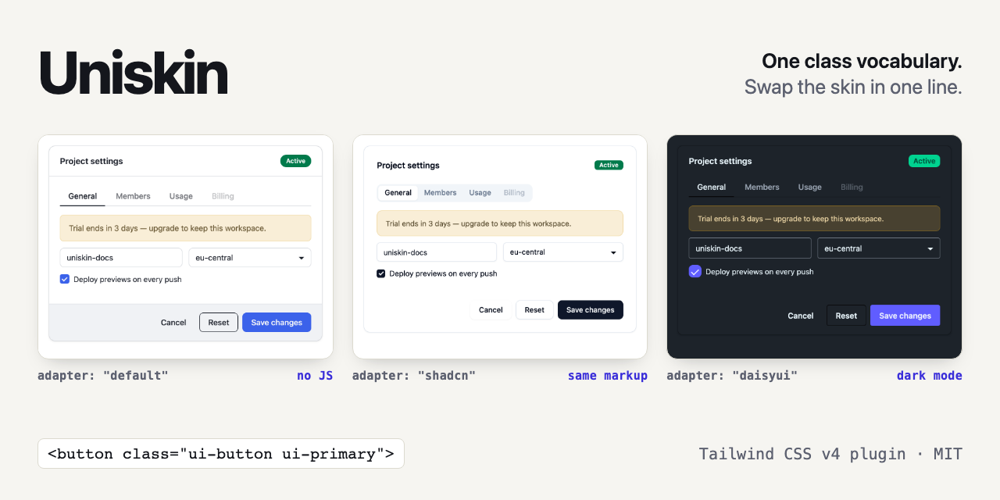

# Uniskin

One class vocabulary, swappable Tailwind CSS v4 skins.

**[Live demo](https://uniskin-css.vercel.app)** · **[Skin builder](https://uniskin-css.vercel.app/builder/)** · [npm](https://www.npmjs.com/package/uniskin) · [Docs](docs/getting-started.md)



Write `ui-button ui-primary ui-md` once — in plain HTML, React, Vue, PHP,
anything. Pick an "adapter" in your CSS to decide how it looks: the
built-in default, a shadcn/ui look, a daisyUI look, or your own. Switching
adapters requires **zero markup changes**. Output is CSS only — no
runtime JavaScript.

```css
@import "tailwindcss";
@plugin "uniskin" { adapter: "shadcn"; }   /* or "daisyui", or "./my-adapter.js" */
```

```html
<button class="ui-button ui-primary ui-outline ui-sm">Save</button>
```

## Quick start

```sh
pnpm add uniskin            # core plugin + built-in default skin
pnpm add @uniskin/shadcn    # optional adapter
pnpm add @uniskin/daisyui   # optional adapter
```

Then in your Tailwind v4 entry CSS, add the `@plugin` line shown above — or let
the CLI do both steps: `npx uniskin init` (see [docs/cli.md](docs/cli.md)).
See [docs/getting-started.md](docs/getting-started.md) for the full guide —
install, adapters, `prefix`, dark mode and troubleshooting.

Compatibility: **tailwindcss ≥ 4.3.3** — verified in CI against 4.3.3 (the
oldest supported 4.x), the version pinned in this repo, and `latest`.
Older 4.x releases compile but are not supported: they serialize plugin
utilities differently, and 4.0.0 does not forward the `@plugin` source
location uniskin uses to resolve relative adapter paths.

Uniskin classes are emitted on demand from Tailwind's automatic content
detection — the same scanning that finds `p-4` finds `ui-button`, in any
file type it scans (HTML, JSX, Vue, PHP, …). If you keep templates in a
file type Tailwind doesn't scan, add an explicit
[`@source`](https://tailwindcss.com/docs/functions-and-directives#source-directive).

## Vocabulary (v1.15)

Prefix is `ui-` by default; change it with `prefix: "uk"` → `uk-button`.

| Kind       | Classes |
|------------|---------|
| Components | `ui-button`, `ui-input`, `ui-textarea`, `ui-select`, `ui-checkbox`, `ui-radio`, `ui-switch`, `ui-field`, `ui-card`, `ui-badge`, `ui-alert`, `ui-modal`, `ui-tabs`, `ui-table`, `ui-accordion`, `ui-progress`, `ui-tooltip`, `ui-toast`, `ui-dropdown`, `ui-menu`, `ui-avatar`, `ui-skeleton`, `ui-separator`, `ui-breadcrumb`, `ui-pagination`, `ui-slider` |
| Parts      | `ui-field-label`, `ui-field-hint`, `ui-field-error`, `ui-card-header`, `ui-card-body`, `ui-card-footer`, `ui-modal-box`, `ui-tab`, `ui-table-wrap`, `ui-accordion-item`, `ui-accordion-trigger`, `ui-accordion-panel`, `ui-tooltip-anchor`, `ui-toast-region`, `ui-menu-item`, `ui-menu-label`, `ui-menu-separator`, `ui-pagination-item` |
| Intent     | `ui-primary`, `ui-secondary`, `ui-success`, `ui-warning`, `ui-danger` |
| Style      | `ui-outline`, `ui-ghost`, `ui-soft` (`solid` is the default) |
| Size       | `ui-sm`, `ui-lg` (`md` is the default) |
| State      | `ui-disabled`, `ui-loading`, `ui-active` |

- Intents and styles combine freely: `ui-danger ui-outline`.
- Modifiers are emitted as compound selectors (`.ui-button.ui-primary`),
  never as global classes — `ui-outline` on a button and a card can look
  completely different.
- States also style the native equivalents: `ui-disabled` ⇔
  `:disabled`/`[aria-disabled="true"]`, `ui-loading` ⇔ `[aria-busy="true"]`,
  `ui-active` ⇔ `[aria-selected="true"]`/`[aria-pressed="true"]`.
- Every interactive component has `:focus-visible` styling.

Status: the full vocabulary ships in the default skin. The shadcn and
daisyUI adapters restyle every component; slots they don't define fall
back to the default skin. Per-component markup, modifiers, native-attribute
equivalents and accessibility notes: [docs/vocabulary.md](docs/vocabulary.md).

Notes:
- `ui-modal` works on a `<div>`, a `<dialog>` (`open` / `showModal()`) or a
  `:target`; add `ui-active` to show a plain `<div>`. Put `ui-modal-box` inside it.
- `ui-tabs` wraps `ui-tab` buttons; mark the current one with
  `aria-selected="true"` (or `ui-active`). Tabs styles: default underline,
  `ui-outline` boxed, `ui-soft` pill, `ui-ghost` text only.
- `ui-card` size (`ui-sm`/`ui-lg`) scales the padding of its header, body and footer.

## Fallback rule

Uniskin ships a complete built-in default style driven by `--ui-*` CSS
variables. An adapter overrides only what it supports; everything else
silently falls back to the default. Built-in adapters are silent; a custom
adapter gets a one-line summary of what falls back, and `debug: true` (or
`UNISKIN_DEBUG=1`) lists every slot.

## Writing your own adapter

```ts
// my-adapter.ts
import { defineAdapter } from "uniskin/adapter";

export default defineAdapter({
  name: "acme",
  tokens: { "--ui-primary": "rebeccapurple" },
  components: {
    button: {
      base: { "border-radius": "999px" },
      styles: { outline: { "border-width": "2px" } },
    },
  },
});
```

```css
@plugin "uniskin" { adapter: "./my-adapter.ts"; }
```

Everything you omit falls back to the default theme. See
[docs/writing-adapters.md](docs/writing-adapters.md) for the full
interface and the `--ui-c` composition model.

## Pairing with JS behaviour

Uniskin is CSS-only. For interactive behaviour pair it with native
`<dialog>` (`ui-modal` styles it), Alpine.js (`x-show` + `ui-*` classes),
or a headless library like Radix/Ark UI — their unstyled components take
`ui-*` classes directly.

## Repo layout

- `packages/uniskin` — the plugin, default theme, adapter interface
- `packages/adapter-shadcn`, `packages/adapter-daisyui` — adapters
- `apps/playground` — Vite demo + manual test (`pnpm dev` in there)
- `docs/` — decisions, adapter guide, [stability and support policy](docs/stability.md)

## Development

```sh
pnpm install
pnpm -r build
pnpm -r test
cd apps/playground && pnpm dev
```

Contributing: see [CONTRIBUTING.md](CONTRIBUTING.md).
